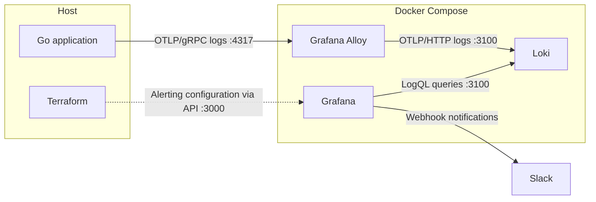
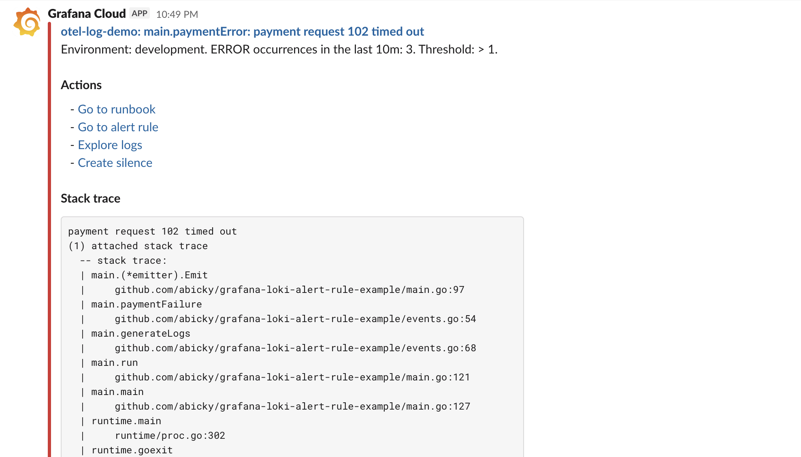

# Grafana Loki alerting with OTLP logs

This repository demonstrates how to turn application errors into grouped Slack
notifications using Grafana and Loki. Its error-fingerprinting approach is
inspired by [Rollbar's grouping algorithm](https://docs.rollbar.com/docs/grouping-algorithm).

For a detailed discussion of the design and implementation, see the
[accompanying article](https://abicky.net/2026/10/13/095730/) (in Japanese).

## Architecture

The demo runs Alloy, Loki, and Grafana in Docker Compose. The Go application
and Terraform run directly on the host.



A small Go application emits structured logs over OTLP. Grafana Alloy forwards
the logs to Loki, while Terraform configures the Grafana alert rule, Slack
contact point, and notification template. Errors are grouped by a stable
fingerprint so that changing details such as request IDs, timestamps, and IP
addresses do not create a separate alert for every occurrence.

The resulting notification includes the latest error message, occurrence count,
stack trace, labels, and links to the relevant runbook, alert rule, logs, and
silence form.



## Prerequisites

- Go 1.27.1
- Terraform 1.16.5
- Docker with Docker Compose
- A Slack incoming webhook for a test channel

## Quick start

1. Create the local environment file and add your Slack webhook URL:

   ```bash
   cp .env.example .env
   ```

   ```dotenv
   SLACK_WEBHOOK_URL=https://hooks.slack.com/services/...
   ```

2. Load the environment variables and expose the webhook to Terraform:

   ```bash
   set -a
   . ./.env
   set +a
   export TF_VAR_slack_webhook_url="$SLACK_WEBHOOK_URL"
   ```

3. Start the observability stack:

   ```bash
   docker compose up -d
   ```

4. Wait for Grafana (http://localhost:3000) to become available, then create
   the alerting resources:

   ```bash
   terraform -chdir=terraform init
   terraform -chdir=terraform apply
   ```

   Review the plan and confirm the apply when prompted. Grafana requires no
   browser login in this demo because anonymous users have Admin access.

5. Start generating demo logs:

   ```bash
   go run -trimpath .
   ```

   The application emits a batch of INFO, ERROR, and FATAL events every five
   seconds. Leave it running long enough for Grafana to evaluate the alert rule
   and send notifications.

> [!CAUTION]
> Terraform state contains the Slack webhook URL. Keep the state private and do
> not commit it. Anonymous Admin access is also intended only for this local
> demo.

## Inspect the logs and alerts

Open [Grafana Explore](http://localhost:3000/explore), select the Loki data
source, and run this query:

```logql
{service_name="otel-log-demo", severity_text=~"ERROR|FATAL|WARN"}
```

You can inspect the three configured rules under [Alerting > Alert rules](http://localhost:3000/alerting/list).
There is one rule for each severity. By default, Grafana evaluates them every
10 seconds and fires when the number of matching events in that rule's window
exceeds its threshold:

| Severity | Window | Alert condition |
| --- | ---: | ---: |
| FATAL | 5 minutes | More than 0 events |
| ERROR | 10 minutes | More than 1 event |
| WARN | 10 minutes | More than 10 events |

FATAL does not need the longer aggregation window used by ERROR and WARN, but
its window remains longer than one minute so that collector buffering or
delayed Loki ingestion does not cause a fatal event to be missed.

Each rule groups events by service, deployment environment, exception type,
severity, and a normalized error fingerprint. It uses the latest matching log
entry to populate the notification details.

## How the alert rules work

The Terraform configuration in `terraform/locals.tf` builds the three alert
rules from shared LogQL query templates and Grafana expressions:

1. **Select candidate log entries.** Each rule reads its WARN, ERROR, or FATAL
   log entries for the configured `service_name`. A log entry with
   `alert.general_rule.exclude=true` is ignored, allowing a dedicated metric-
   or log-based rule to handle that occurrence instead. Loki stores
   `severity_text` as an indexed label, so each selector scans only streams for
   its rule's severity instead of every log stream for the service.

2. **Create an error fingerprint.** For typed exceptions with a stack trace,
   the rule removes variable wrapper messages while retaining the stack frames,
   their order, and line numbers. This normalization is designed for
   `exception.stacktrace` output generated by `errors.Formattable` from the
   `github.com/cockroachdb/errors` package. If no usable typed stack is
   available, the rule normalizes UUIDs, IPv6 addresses, hexadecimal values,
   and digits in the log message. This fingerprint becomes the `error_group`
   label.

3. **Count matching occurrences.** Each rule counts error occurrences over its
   configured window, grouped by service, deployment environment, error
   fingerprint, exception type, and severity. Grafana compares the count with
   that rule's threshold. At each 10-second evaluation, every rule's count and
   latest-entry queries scan that rule's window.

4. **Attach details from the latest log entry.** A separate query in each rule
   finds the newest log entry in each group and supplies its message, stack
   trace, and timestamp range to the notification. Those timestamps are used
   to build a Grafana Explore link showing logs from the same service and
   deployment environment around the time of the latest entry.

5. **Choose a runbook.** If the latest log entry has a `runbook_url` attribute,
   the notification uses it. Otherwise, the rule looks for a fallback URL in
   the Terraform local value `local.runbook_urls`, which maps exception types
   to runbook URLs. If neither exists, the notification omits the runbook link.

6. **Send a grouped notification.** Grafana groups notifications by the alert
   name, folder, and the same labels used by the LogQL aggregation. The Slack
   message includes the latest error, the occurrence count and threshold, the
   stack trace, remaining labels and annotations, and available links to the
   runbook, alert rule, logs, and silence form.

## FATAL severity handling

`otelslog` does not provide a predefined FATAL level. The Go application
therefore defines a custom `slog` level above ERROR in `events.go`. The bridge
maps that level to the OTLP fatal severity range, and the transformation in
`config/config.alloy` converts its `severity_text` to `FATAL` before forwarding
the log entry to Loki.

```go
// slog.LevelError is 8; this custom level is 12.
const levelCritical = slog.LevelError + (slog.LevelError - slog.LevelWarn)

logger.LogAttrs(ctx, levelCritical, "service cannot continue")
```

`otelslog` maps level 12 to OTLP severity number 21. Alloy then applies two
transformations:

```alloy
otelcol.processor.transform "severity" {
  log_statements {
    context = "log"
    statements = [
      `set(severity_text, "FATAL") where severity_number >= 21 and severity_number <= 24`,
      `set(attributes["severity_text"], severity_text)`,
    ]
  }
}
```

- The first statement replaces source-specific text such as `ERROR+4` with
  `FATAL` when the numeric severity is between 21 and 24, the
  [OTLP FATAL range](https://opentelemetry.io/docs/specs/otel/logs/data-model/#field-severitynumber).
  The alert rule can therefore select all fatal entries using the consistent
  label value `FATAL`.
- The second statement copies the normalized top-level `severity_text`
  LogRecord field into the `severity_text` attribute. Self-hosted Loki can
  index the top-level field with `severity_text_as_label=true`, but
  [Grafana Cloud does not allow that setting](https://grafana.com/docs/grafana-cloud/platform/security-and-account-management/account-management/cloud-stacks/grafana-dbcfg-app/logs/#otlp-label-mappings).
  This demo instead uses `limits_config.otlp_config.log_attributes` to promote
  the copied attribute to an index label, an approach that also works with
  Grafana Cloud.

## Apply configuration changes

After changing a Terraform-managed alert rule or contact point, apply the
configuration again:

```bash
terraform -chdir=terraform apply
```

Grafana does not need to restart. Alerting provenance is disabled to make the
resources easier to inspect and edit in the UI, but a later Terraform apply can
overwrite those UI changes.

After changing a file-provisioned Grafana data source, restart Grafana:

```bash
docker compose restart grafana
```

You can alternatively call
`POST /api/admin/provisioning/datasources/reload` with server-admin
credentials; anonymous organization Admin access is insufficient. Restart the
corresponding service after changing the Alloy or Loki configuration.

## Stop and clean up

Press <kbd>Ctrl</kbd>+<kbd>C</kbd> to stop the Go application and flush its
pending OpenTelemetry logs.

While Grafana is still running, remove the Terraform-managed alerting resources
after reviewing the destroy plan:

```bash
terraform -chdir=terraform destroy
```

Then stop the containers while preserving Loki and Grafana data:

```bash
docker compose down
```

To also delete the local Loki and Grafana data, remove the project's named
volumes:

```bash
docker compose down -v
```

The final command permanently deletes the stored demo data.
